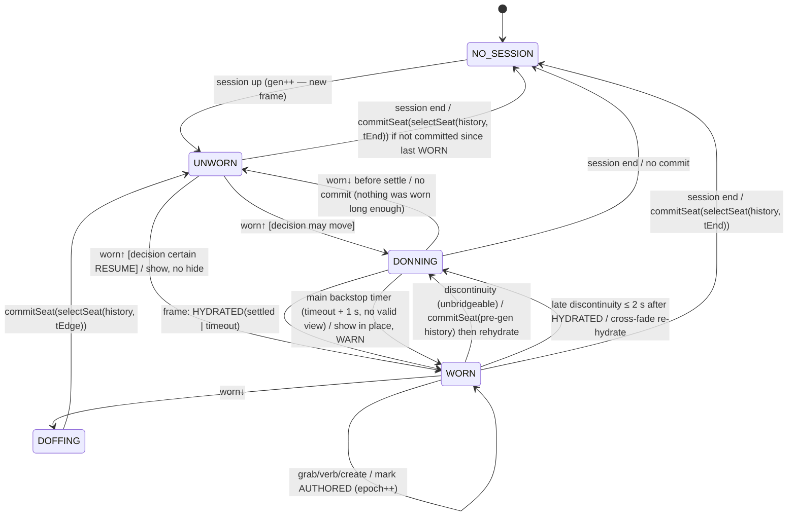

# 30 — Don/doff intent: a state machine for hydrating and dehydrating the room

**Status:** design only (2026-10-15). Nothing here is implemented. It replaces the cross-session
placement capture → staging → commit-gate → recenter-on-plug pipeline documented in
[doc 03 §8.2–§8.3](../03-anchoring.md#82-recenter-on-plug) and built by
[research/28](28-spatial-model.md) tranche 1 (H2). It keeps that work's invariants (I3, I4, I9, I11,
I12, I14 of research/28 §8.1). What it removes is the one design choice that failed live: *the last
frame before the wearing gate shuts is the memory*.

**Audience:** the agent who implements it. Every piece of existing code that this design replaces or
touches has a `file:line` reference against `hypxrland` at `21e863220`.

---

## TL;DR

1. **The memory comes from the last place the user dwelled while working. It does not come from the
   last frame.** At a doff edge we look back through a recorded pose history. We skip the take-off
   motion, which we find by detecting where the motion starts, not with a fixed time offset. The seat
   we commit is the most recent *dwell episode* (several seconds, upright, at one place) whose
   arrangement was actually in front of the user. The seat's yaw is the circular mean over the dwell,
   not one sample, so neither the take-off flip nor a glance at a side monitor can define it.
2. **A candidate is accepted on its own evidence. It is never compared against the old memory.**
   The 2.5 m drift gate (`xrRestoreCommitGate`) is deleted. That gate refused a *correct* capture
   because it disagreed with a *wrong* memory, which made one bad commit permanent. Its replacement
   asks whether the candidate is a real dwell, tracked, upright, and facing the monitors. A ~180°
   flip at a similar distance fails the facing test by construction, whatever the old memory says.
3. **Deliberate actions commit right away.** A re-seat (`xrmonitor reseat`, SUPER+CTRL+Home) writes
   the memory immediately from the planted offsets. A grab, push-pull, verb or create marks the
   arrangement user-authored. A bad memory can therefore always be corrected with one keypress.
4. **On don, wait for the head to settle before anything moves, and hide what might move.** The
   current re-seat samples "forward" 35 ms after the presence edge, while the user is still
   adjusting the glasses. The new path holds monitors invisible while a settle detector watches
   angular speed, level pitch/roll, tracking and (in 6DoF) linear speed for a hold time, with a
   timeout fallback. It then hydrates and fades in.
5. **Resume in place versus rehydrate around the head is a pure decision on evidence.** Inputs are
   whether this is the same session, whether the tracking-origin generation is bridgeable, the DoF,
   tracking continuity, and how far the head is from the seat it left. 6DoF lets a brief doff at the
   same desk resume with no re-seat at all. 3DoF and no-evidence cases keep today's in-session
   behavior (no re-seat). New sessions and unbridgeable origins rehydrate head-relative.
6. **History is multi-resolution and stays in memory.** Full rate covers roughly the last 20 s. It
   is followed by 250 ms, 2 s, 15 s and 2 min tiers out to about 34 h, plus a semantic tier of dwell
   episodes. Each tier holds summaries that preserve dwell and stability statistics, not subsamples.
   The total is about 0.6 MiB. The frame thread writes POD under its own mutex. No history is
   persisted, because positions in a dead session frame are meaningless after a restart and keeping
   a head trajectory on disk is a privacy cost with no benefit. Only committed head-relative memories
   may be persisted later, as an opt-in.

---

## 1. Problem statement

### 1.1 What is built today

* The frame thread **stages** each `anchor:local` monitor's head-relative offset on every frame while
  the capture gate is open: `OpenXRManager.cpp:2302-2356`, into `CXRMonitorLayer::m_restoreStaged`
  at `XRMonitorLayer.hpp:142-148`. The gates are `headTrustworthy` (`OpenXRManager.cpp:2041-2062`),
  `qYawObservable`, `m_restoreCapture`, and `xrAnchorFrameReestablished`.
* The capture gate is `visible && wearing` (`publishRestoreCapture`, `OpenXRManager.cpp:4383-4417`).
  When it **closes** (doff, visibility drop) the main thread runs `commitRestorePlacements`
  (`:4419-4452`), and it runs again at session end (`:1109-1116`). Each staged value is promoted
  into `m_restoreOffset` only through `xrRestoreCommitGate` (`XRAnchor.hpp:283-336`). That gate
  applies an 8 m reach / 4 m height bound to a first commit, and a **2.5 m horizontal drift** bound
  against the previous memory.
* On the **first plug of a session**, `updateMonitorsPlugged` arms a `RESTORE` re-seat
  (`OpenXRManager.cpp:4256-4279`). The frame thread consumes it on the next valid-view frame
  (`:2223-2300`), planting `m_restoreOffset` around the current head. The §8.1 tracking-gap fallback
  `handleFrameDiscontinuity` (`:4473-4502`) arms the same re-seat.
* The deliberate `GROUP` re-seat (`requestReseatToHead`, `:4534-4600`) moves the live arrangement
  onto the head. It does **not** touch `m_restoreOffset`. The memory only changes at the next
  successful commit, and that commit goes through the drift gate.

### 1.2 The log evidence

From the live log `/run/user/1000/hypr/d6ba8401d…/hyprland.log`, 2026-10-13 22:25 to 2026-10-15
(XREAL Air 2 Ultra, Monado, presence supported):

| time | log | meaning |
|---|---|---|
| 10-13 22:28:57.310 | `re-seated 1 … 0 restored from the last wearing, 1 from their declared rig` | XR-main has **no memory** this session. It came from its declared rig. |
| 10-13 22:43:56.190 | `user disable …` (`hyprctl openxr disable`, no presence-absent edge before it) | Session teardown commit. Presence still read *present*. |
| 10-13 22:43:56.201 | `refusing to remember 'XR-2' … staged [-0.65, 1.55, 1.78] vs remembered [0.00, 1.55, -1.90]` (same for XR-3 and XR-4, all with z flipped positive) | The last staged head was **facing backwards** |
| 10-13 22:43:56.201 | `placement commit (the session is ending): 1 remembered, 3 refused` | XR-main had no prior memory, so only the 8 m reach bound applied. **The flipped capture `[0.70, 1.64, 1.78]` was committed.** |
| 10-14 21:06:34.523 | `re-seated 4 … 4 restored from the last wearing` | XR-main restored **behind** the user |
| 10-14 21:17:46.950 | `refusing to remember 'XR-main' … staged [-0.28, 1.56, -1.89] vs remembered [0.70, 1.64, 1.78]` | A *correct* capture refused as "drifted, that was a walk" |
| 10-15 09:37:05.146 | the same, `staged [0.21, 1.61, -1.63]` | refused again, so the memory is permanent |
| 10-15 09:39:06.943 | `user presence changed -> absent`, then XR-2..5 `staged [-0.13, 0.54, 2.06] vs remembered [0.16, 0.54, -1.51]` … | a presence doff: **every** monitor staged mirrored, x and z sign flipped |
| 10-15 12:49:48.292 → .327 | `presence -> present` … `re-seated 5 …` | the don re-seat ran **35 ms** after the edge |
| 10-15 12:51:46 / 12:52:10 / 12:52:27 | XR-main `staged [-0.03, 1.67, -2.15]`, `[0.45, 1.67, -2.12]`, `[-0.14, 1.67, -2.21]` vs `remembered [-0.23, 1.61, 2.06]` | three correct doffs in a row, all refused |
| 10-15 12:59:38.664 | XR-2..5 staged mirrored again | the flip recurs on roughly half the doffs |
| 10-15 13:02:12 … 13:02:18 | seven `xrmonitor reseat` presses in six seconds | the user tried to fix it with the only tool available. That tool cannot fix the memory. |

### 1.3 Root causes

| # | cause | where |
|---|---|---|
| **R1** | **The take-off motion is in the staged stream.** XREAL presence is a proximity sensor, debounced **400 ms** in Monado (`subprojects/monado/src/xrt/drivers/xreal_air/xreal_air_hmd.c:1429-1433`, `XREAL_AIR_PRESENCE_DEBOUNCE_NS`). The edge reaches us roughly 0.4 s after the glasses leave the face, plus however long the hand was already lifting them. Every frame in that window is staged, and the last one wins. | `OpenXRManager.cpp:2329-2356` |
| **R2** | **A head pitched past vertical yields a 180° yaw.** Lifting glasses up and toward yourself (or parking them on the forehead) pitches "forward" up and *backwards*. `qYawObservable` only rejects forward vectors whose horizontal component is under 1e-4 (`XRMath.hpp:174-177`), so a forward vector at 110° pitch is "observable" and `qYawOf` returns yaw+180°. The head frame is mirrored, and so is every offset staged against it. This is exactly the observed `(x, z) → (-x, -z)`. At 22:43:56 the flip happened with **no presence edge at all**. The likely explanation is glasses pushed up onto the forehead (sensor still covered) before running `openxr disable`. | `XRMath.hpp:171-185`, `xrHeadFrame` `:361` |
| **R3** | **The drift gate compares against the memory, so a bad memory refuses every good capture.** It was designed on the assumption that "a re-seat makes the two equal by construction" (`XRAnchor.hpp:296-301`). That is false once the memory is wrong, because the re-seat then *plants the wrong memory* and the live capture measures how far the user turned to face their monitors. | `XRAnchor.hpp:314-326` |
| **R4** | **A first commit has only a reach bound.** A flipped capture at a normal distance passes 8 m trivially. | `XRAnchor.hpp:323-325` |
| **R5** | **A deliberate re-seat never refreshes the memory.** `GROUP` moves the live arrangement. The memory only changes at the next commit, which R3 refuses. | `OpenXRManager.cpp:2247-2275`, `:4534-4600` |
| **R6** | **The don re-seat samples "forward" mid-motion.** It is armed on the presence edge and consumed on the very next valid frame (35 ms later, see the log). | `OpenXRManager.cpp:4256-4279`, `:2223-2227` |
| **R7** | **One instantaneous yaw defines the whole arrangement.** Even with no flip, a doff while glancing at a side monitor stores the arrangement rotated by that glance. A user who works across three monitors has no single "forward". | same as R1 |

R1, R2 and R4 together make the bad memory. R3 and R5 make it permanent. R6 and R7 make even good
memories land a little wrong.

---

## 2. Goals, non-goals, invariants

**Goals.** Interpret wear-state edges as *intent*, and only then (de)hydrate. Never commit a memory
the user did not work from. Never let a bad memory be sticky. Never visibly move monitors while the
user is still putting the glasses on. Use 6DoF and room evidence where they exist, and degrade to
today's behavior where they do not. All decisions must be pure functions that can be tested with
gtests over synthetic and recorded traces.

**Non-goals.** Track W of research/28 (world-frame binding in STAGE) is out of scope. This design
leaves room for it: the STAGE bridge in §5.5 is its first consumer. Also out of scope: changing
*when outputs plug* (`openxr:monitors_follow_session`, the unplug grace, `monitor_plug_settle_ms`).
The FSM sits next to the plug funnel and does not replace it.

**Invariants carried from research/28 §8.1.** I3 (only TRACKED, finite poses feed durable state),
I4 (authored beats live), I9 (every refusal is logged and visible in status), I11 (durable state is
written on the main thread, at an edge), I12 (one hydration path), I14 (a repair never puts content
out of reach).

**New invariants.**

| # | invariant |
|---|---|
| **D1** | A memory is derived from a **window** of evidence, never from a single frame. |
| **D2** | Acceptance is **intrinsic**. A candidate is judged on its own evidence. The previous memory never vetoes a candidate whose evidence is *stronger*. |
| **D3** | A seat whose arrangement is **behind** it (bearing > 100°) is never committed. |
| **D4** | A deliberate user action can always replace the memory, immediately. |
| **D5** | Nothing that will be moved by hydration is visible before the hydration pose is chosen. |
| **D6** | History is POD, fixed capacity, in-process memory only. No head trajectory is written to disk except by an explicit, opt-in trace recording. |

---

## 3. Architecture

Three pieces, split along the existing thread boundary:

```
                    FRAME THREAD (owns head pose)                     MAIN THREAD (owns edges + durable state)
┌───────────────────────────────────────────────────┐       ┌───────────────────────────────────────────────┐
│ locate head → SXRHeadFeatures (ω, v, pitch, upY,  │       │ CXRDonDoffFsm (pure transition fn + timers)   │
│   flags)                    xrHeadFeatures()      │       │  inputs: presence, visibility, session up/down│
│ CXRPoseHistory::push()  ──── m_historyMu ─────────┼──────►│  discontinuity, frame events, verbs           │
│   T0 ring + tier accumulators + episode detector  │ read  │  on DOFF/END: xrSelectSeat(history) →         │
│                                                   │ at    │    commitSeat() → m_restoreOffset (+prov.)    │
│ if phase==DONNING: CXRSettleDetector.step()       │ edges │  on DON: publish SXRDonContext + phase        │
│   settled|timeout → xrDonDecision(ctx, settle)    │       │                                               │
│   → hydrate (existing reseat consume path)        │◄──────┤  m_donPhase (atomic u8), m_donToken (u32)     │
│   → hydration alpha fade (frame-thread float)     │ atomics  SXRDonContext under m_layersMu (POD)       │
│   → push HYDRATED{decision,…} on frame→main queue ├──────►│  → DONNING→WORN, log, status                  │
└───────────────────────────────────────────────────┘       └───────────────────────────────────────────────┘
```

New files, compiled **unconditionally** (no OpenXR headers) so `hyprland_gtests` links them the way
it links `XRQueue.hpp` and the pose ring:

* `src/openxr/XRPoseHistory.hpp/.cpp`: the record types, the tiered history, decimation, and the
  episode detector.
* `src/openxr/XRDonDoff.hpp/.cpp`: feature extraction, the settle detector, onset detection, seat
  selection, plausibility, `xrDonDecision`, and the FSM transition function.

Function bodies go in the `.cpp` (AGENTS.md: avoid bodies in headers). The existing all-inline
`XRAnchor.hpp` is not the model to copy.

`COpenXRManager` gains a thin adapter: the FSM instance, `m_historyMu`, the publish atomics, and the
event plumbing. The pure functions do all the deciding.

---

## 4. The state machine

### 4.1 The wear signal

One derived boolean, `worn`, with its source recorded:

| runtime | `worn` | source tag |
|---|---|---|
| `XR_EXT_user_presence` supported and known | `present && sessionVisible()` (WiVRn's presence sticks *present* in standby, so visibility is ANDed, like `inhibit_idle = present`) | `presence` |
| presence supported, not yet known | `sessionVisible()` | `visibility (presence pending)` |
| no presence | `sessionVisible() && !deadStill` | `visibility` |

`deadStill` is a new frame-thread flag (§8.2). It is raised when angular-speed RMS over 2 s is below
0.2°/s **and** (6DoF) positional jitter is below 1 mm. A worn head is never that still, because
physiological tremor and breathing give a 0.5–3°/s floor. It only feeds `worn` on runtimes without
presence, as the "headset lying on the desk while the session is still VISIBLE" detector. The
current code has nothing like it and relies on the runtime's eventual visibility drop. The threshold
is a tuning target for the trace corpus (§13).

### 4.2 States

| state | meaning | monitor quads | history |
|---|---|---|---|
| `NO_SESSION` | no XR session | n/a | not written |
| `UNWORN` | session up, `worn == false` | as today (they unplug after the grace, per `monitors_follow_session`) | written, flagged `!WORN` |
| `DONNING` | `worn` rose and a hydration may move monitors. Waiting for the head to settle. | **hidden** (hydration alpha 0) when the pending decision may move them; shown when it is certain to be `RESUME` (§5.4) | written |
| `WORN` | hydrated and in use | visible | written, dwell detection active |
| `DOFFING` | transient: `worn` fell. Seat selection and commit run on this edge, then → `UNWORN` | unchanged | written |

`DOFFING` is a named state, not just a function call, so the commit runs **exactly once per edge**
(research/28 S16 idempotence) and status can say "doff commit pending" if the history lock is
contended.

### 4.3 Transitions



The transition function is pure:

```cpp
// XRDonDoff.hpp
enum eXRDonState : uint8_t { XR_DON_NO_SESSION, XR_DON_UNWORN, XR_DON_DONNING, XR_DON_WORN, XR_DON_DOFFING };
enum eXRDonInput : uint8_t { XR_DIN_SESSION_UP, XR_DIN_SESSION_DOWN, XR_DIN_WORN_UP, XR_DIN_WORN_DOWN,
                             XR_DIN_HYDRATED, XR_DIN_BACKSTOP, XR_DIN_DISCONTINUITY, XR_DIN_RESEAT_DONE,
                             XR_DIN_AUTHORED };
struct SXRDonStep { eXRDonState next; uint8_t actions; /* bitmask: COMMIT_FROM_HISTORY, COMMIT_RESEAT,
                    PUBLISH_DONNING, SHOW_IN_PLACE, MARK_AUTHORED, LOG_WARN */ };
SXRDonStep xrDonTransition(eXRDonState s, eXRDonInput in, const SXRDonFacts& facts);
```

`SXRDonFacts` holds the booleans the guards read: whether the pending decision is certainly a
`RESUME` (§5.4), whether the last discontinuity was late, whether a commit already happened since
the last `WORN`, and `recenter_on_plug`. The manager feeds inputs from the sites listed in §10 and
executes the action bits.

### 4.4 Relationship to the plug funnel

`updateMonitorsPlugged` (`OpenXRManager.cpp:4221`) keeps deciding *plugging*: the anti-flap grace,
the first-plug settle, and the `off`/`session`/`visible` modes. It stops *arming re-seats*. Its
first-plug `armReseat(RESTORE)` (`:4256-4279`) is deleted, and the FSM's `DONNING` entry takes over
that job. The two run side by side from the same edges. `publishRestoreCapture()` is replaced by
`feedDonDoff()`, called from the same place (`:4249`) and from `resetPresenceState` (`:3796`).

Plugging can happen immediately on don, as it does today. Workspaces return while the quads are
still hidden, so the Wayland-side cost is paid during the settle instead of after it.

---

## 5. Don: settle, hide, decide, hydrate

### 5.1 Per-frame head features (frame thread, pure)

```cpp
struct SXRHeadFeatures {
    float angSpeed;    // rad/s, 2*acos(|q_prev·q|)/dt, then EMA τ = 80 ms
    float linSpeed;    // m/s, |Δp|/dt, EMA τ = 120 ms (meaningful only when posTracked)
    float pitch;       // rad, asin(forward.y)
    float upY;         // head +Y in world, y component = cos(tilt from upright)
    float yaw;         // rad, qYawOf — valid only when `upright`
    bool  upright;     // upY ≥ 0.5 (pitch and roll combined under 60°), the R2 fix
    bool  level;       // |pitch| ≤ 35° && upright
    bool  still;       // angSpeed < 20°/s && (!posTracked || linSpeed < 0.10 m/s)
};
SXRHeadFeatures xrHeadFeatures(const SXRPose& prev, const SXRPose& cur, float dt, const SXRHeadFeatures& prevF, bool posTracked);
```

`upright` is the direct fix for R2. A head pitched past vertical has `upY < 0`, and no yaw is ever
read from a non-upright sample, for display or for memory. `qYawObservable` stays as the display
fallback guard. Durable code uses `upright` instead.

### 5.2 Settle criteria (initial thresholds)

The detector is a small frame-thread state machine (`CXRSettleDetector`, pure: `step(features,
flags, tNs) → {WAITING | SETTLED | TIMEOUT}`), reset on each `DONNING` entry by `m_donToken`.

| criterion | initial value | why |
|---|---|---|
| minimum delay after the edge | 150 ms | XREAL's edge already trails contact by the 400 ms debounce. This only guards a sensor that reports instantly. |
| hold window | **500 ms** continuously satisfying all of the rows below | long enough to span a "push the glasses up the nose" adjustment |
| angular speed | max over the hold < **30°/s**, mean < **12°/s** | reading-level head motion is 5–20°/s and fitting the glasses is 60–200°/s |
| pitch | \|pitch\| ≤ **35°** | covers looking down at a keyboard without accepting the forehead-park pose |
| roll / upright | `upright` and \|roll\| ≤ **20°** | |
| tracking | `TRACKED`, under the existing conditional rule (`headTrackedEverSeen`, `OpenXRManager.cpp:2053-2062`) | I3 |
| 6DoF linear | max `linSpeed` < **0.15 m/s** | also absorbs XREAL SLAM's 2 s re-acquisition glide (07-xreal.md §1.6) |
| **timeout** | **3000 ms** after the edge | |

**The hydration pose is the hold window's mean**: arithmetic mean of position, and circular mean of
yaw over `level` samples. It is never the last sample.

**Timeout fallback ladder** (each rung logged with its reason):

1. The best 300 ms sub-window seen since the edge that was `upright && level` (lowest mean ω). This
   is the "kept moving but did look forward for a moment" case.
2. Otherwise the most recent `upright` sample with \|pitch\| ≤ 60°. This is the reclined-user case.
   It fires only after the timeout, so the user waits 3 s.
3. Otherwise **show in place without moving** (`RESUME` semantics) and WARN
   `don settle timed out with no upright head — showing monitors where they are`. A user lying flat
   or holding the glasses in a hand gets *something* visible. Nothing durable comes from it.

**Backstop.** If the frame thread never produces `HYDRATED` because no valid view arrived, a
main-thread `CEventLoopTimer` at `timeout + 1000 ms` takes rung 3. The user is never left blind.

### 5.3 Hide and fade

Today's alpha machinery is main-thread (`m_fxAlpha` envelopes on an 8 ms tick,
`XRMonitorLayer.hpp:325-350`). The don fade has to start on the exact frame the hydration lands,
so it is **frame-thread-owned**: one `float m_hydrationAlpha` per manager, multiplied into the
uniform monitor alpha at the blit. It sits next to `m_fxAlphaDrawn`, so the redraw diff
(`XRMonitorLayer.hpp:348-350`) recomposes animation-only frames. While `DONNING` and hidden, the
value is 0 and quads may simply be left out of the submitted layer list, which saves the
composition too. After `HYDRATED` it eases 0 → 1 over **180 ms** (smoothstep). A late-discontinuity
re-hydrate cross-fades: 120 ms out, hydrate, 180 ms in.

Only `anchor:local` monitors are hidden. `head`/`body`/`device` monitors ride the user and never
jump, so hiding them would just blank the view for nothing. The HUD (`hypxrhud`, its own session)
is unaffected.

### 5.4 The resume-versus-rehydrate decision

The main thread builds an `SXRDonContext` on `DONNING` entry and publishes it under `m_layersMu` with
the new token. The frame thread then evaluates:

```cpp
enum eXRDonDecision : uint8_t { XR_DON_RESUME, XR_DON_REHYDRATE_MEMORY, XR_DON_REHYDRATE_DECLARED, XR_DON_HOLD_DEAD };
enum eXRGenBridge   : uint8_t { XR_BRIDGE_SAME, XR_BRIDGE_KNOWN, XR_BRIDGE_STAGE, XR_BRIDGE_UNKNOWN };
struct SXRDonContext {
    uint32_t token;
    bool     sameSession;        // no session restart since the doff seat was recorded
    bool     haveDoffSeat;       // the doff commit found a seat (pos in gen `seatGen`)
    Vec3     doffSeatPos;  float doffSeatYaw;  uint16_t seatGen;
    uint8_t  dof;                // 6 | 3 — POSITION_TRACKED ever seen this session
    bool     posContinuity;      // 6DoF: no POSITION_TRACKED gap > 1 s across the unworn period
    bool     recenterOnPlug;     // openxr:recenter_on_plug (or recenter = follow)
    float    resumeRadius;       // m
};
eXRDonDecision xrDonDecision(const SXRDonContext& c, eXRGenBridge bridge, const SXRPose& settledHeadInSeatGen, bool anyMemory);
```

| # | condition (first match wins) | decision | today's behavior for comparison |
|---|---|---|---|
| 1 | `!recenterOnPlug` and the frame is bridgeable or same session | `RESUME`, no hide | first plug re-seats only when `recenter_on_plug` is true. With it false, nothing moves. |
| 2 | `!recenterOnPlug` and the frame is dead | `HOLD_DEAD`: show in place plus the existing WARN (`OpenXRManager.cpp:4501`) | same |
| 3 | `!sameSession` | `REHYDRATE_MEMORY` (or `_DECLARED` when there is no memory), **hidden until settle** | first plug `RESTORE`, 35 ms after the edge |
| 4 | bridge `UNKNOWN` (an unreconstructable discontinuity during the unworn period, e.g. Quest re-don `LOCAL_FLOOR` re-derive with `poseValid = false`) | `REHYDRATE_MEMORY`, hidden | `handleFrameDiscontinuity` `RESTORE` |
| 5 | 6DoF, `posContinuity`, bridge ∈ {SAME, KNOWN, STAGE}, horizontal \|settled − doffSeat\| ≤ `resumeRadius` (**0.75 m**) | `RESUME`, **no re-seat**. World poses are still valid. | no re-seat (in-session re-plug) |
| 6 | 6DoF, displacement > `resumeRadius` | `REHYDRATE_MEMORY`: you moved, so the room comes with you | **no re-seat** (monitors left at the old desk) — *behavior change, see §14* |
| 7 | 3DoF, or 6DoF without continuity, and the bridge is not UNKNOWN | `RESUME` | no re-seat |

Rows 5 and 7 can be decided **at the edge** for 3DoF (row 7 needs no pose). In 6DoF, position at the
edge is already good enough for a 0.75 m test, because walking to another room is metres and
settling is centimetres. When the edge already yields `RESUME`, the FSM goes `UNWORN → WORN`
directly and **nothing is hidden**. A brief doff at the desk therefore has zero added latency. Only
rows 3, 4 and 6 hide and wait for the settle.

Row 6 needs the settled pose for *where* to rehydrate, not for *whether*. It is decided at the edge
but executed after the settle.

**Why rows 5 and 7 resume rather than rehydrate.** research/28 §7.3 argues "re-seat when the evidence
does not vouch for the place". Its strongest counter-example is Sightful's "Putting the glasses back
on no longer … reorients your workspace", and for an in-session brief doff that counter-example
wins: the user put the glasses down mid-task. Today's in-session behavior is already "don't move".
This design keeps it and adds the one case where 6DoF gives *positive* evidence of a move (row 6).

### 5.5 Origin generations and the bridge

A per-session `uint16_t originGen` is incremented at every event that changes what a `LOCAL_FLOOR`
coordinate means:

| event | site | bridge to the previous gen |
|---|---|---|
| session start | `OpenXRManager.cpp:855` (`invalidateAnchorFrames` at start) | `UNKNOWN` (new frame) |
| reference-space change with `poseValid` | §8.1 ladder row 1 | `KNOWN` (M stored) |
| reference-space change reconstructed from the head | §8.1 ladder row 2 | `KNOWN` (M stored) |
| tracking-gap / unresolvable STAGE change | `handleFrameDiscontinuity` (`:4473`), `:2139`, `:1588` | `UNKNOWN`, unless the STAGE bridge applies |

The generation table is a 64-entry ring of `{gen, tNs, cause, bridge, SXRPose M}` (POD). It is
written wherever `invalidateAnchorFrames` / `onReferenceSpaceChanged` already run.

**The STAGE bridge** (Phase 3, gated on research/28 M0). If STAGE was located and `TRACKED` on both
sides of an `UNKNOWN` change, and `m_worldChangesUnresolvable` did not move, then
`M = T_new←stage ∘ inv(T_old←stage)` is known. It is computed from the existing 1 Hz M0 probe
(`T_localfloor←stage`, `OpenXRManager.cpp` after `:2064`). This is the only thing that can turn a
Quest re-don (which always re-derives `LOCAL_FLOOR`) into a `RESUME`. Until M0 shows that STAGE is
stable under BOUNDARYLESS_APP, the bridge stays off.

### 5.6 Executing the hydration

This reuses the existing consume path (`OpenXRManager.cpp:2223-2300`) and does not add a fourth
branch (I12):

* `REHYDRATE_*` is today's `RESTORE` body with one change: `viewPose` is replaced by the **settled
  head pose** (the hold-window mean, §5.2). `recenterLocalToHead` (`XRAnchor.cpp:1115`) and
  `xrReseatSource` are unchanged.
* `RESUME` re-seats nothing. It clears `m_anchorFrameStale` only when the bridge is `SAME`. With
  `KNOWN`/`STAGE` it first applies `onReferenceSpaceChanged(M)`, exactly as §8.1 row 1 does.
* The frame thread then pushes `HYDRATED{token, decision, rung, settleMs, ωmax, pitch}` on the
  existing frame→main SPSC queue (`XRQueue.hpp`). The main thread logs it and makes the FSM step.

A **late discontinuity** that arrives within 2 s after `HYDRATED`, typically Quest's `LOCAL_FLOOR`
re-derive landing after the presence edge, re-enters `DONNING` with a cross-fade, so the
rehydration is not visible as a jump. Its frequency is a measurement target for the Quest traces
(§13.4). If it is the norm, `DONNING` should require `presence + one frame after the first
post-don reference-space event, or 1 s` before settling on WiVRn.

---

## 6. Doff: find the seat the user worked from

### 6.1 Motion onset (pure, over T0)

```cpp
struct SXROnset { bool found; int64_t tOnsetNs; int64_t quietStartNs; };
SXROnset xrFindMotionOnset(const CXRPoseHistory& h, int64_t tEdgeNs, const SXROnsetParams& p);
```

Scan T0 **backwards** from `tEdge`. `tOnset` is the end of the latest window of length
`quietMin` = **750 ms** in which every sample is `QUIET`
(`WORN && trusted && upright && level && still && !deadStill`). The search is bounded by
`onsetMaxBack` = **8 s**. If the user was in motion for 8 s before the edge, they were not "at the
desk" at that moment, and the scan hands over to the episode tier. This is motion-onset based by
construction: a slow doff and a fast doff find different onsets, and no fixed offset is involved.

`deadStill` samples are excluded from `QUIET`. On a no-presence runtime, the seconds a headset spends
lying on the desk before the visibility drop are exactly what must *not* count as a quiet working
window.

### 6.2 Dwell episodes (online, frame thread)

The episode detector is the semantic heart of the history (`CXREpisodeDetector`, pure, stepped once
per T0 push):

* **Opens** when the head stays within `seatRadius` = **0.35 m** horizontally of a running anchor for
  `dwellMin` = **8 s** of `WORN && trusted` samples, of which ≥ **70 %** are `level`. In 3DoF there
  is no position, so only the wear, trust and level conditions apply. Yaw is **not** constrained:
  working across a monitor wall is still one dwell.
* **Accumulates** (all associative sums): sample count, time, Σpos over `level` samples, (Σcos yaw,
  Σsin yaw) over `level && still` samples, position AABB, max ω, `gazeOnMonitorMs` (the existing
  gaze pass's raw hit id ≠ −1, `XRMath.hpp:611-612`), and a per-monitor gaze histogram (top 4 ids by
  dwell time, as `uint32` monitor ids, never strings).
* **Closes** when the head is outside `seatRadius` for more than 1.5 s (a walk), `WORN` falls (the
  episode is closed at `tOnset`, not at the edge, so the take-off is never inside it), `originGen`
  changes to an unbridgeable gen, or the session ends.
* **Seat pose** = `{pos: Σpos / n, yaw: atan2(Σsin, Σcos)}`. The resultant length
  `R̄ = |Σ(cos, sin)| / n` is stored. When `R̄ < 0.4` (the user looked everywhere evenly), the seat
  yaw is taken from `xrGroupSeatFrame` of the arrangement instead (`XRAnchor.hpp`, the GROUP
  re-seat's implied viewer). With no stable gaze direction, the arrangement says where "forward" is.

### 6.3 Seat selection and intrinsic acceptance

```cpp
enum eXRSeatSource : uint8_t { XR_SEAT_NONE, XR_SEAT_DWELL, XR_SEAT_QUIET, XR_SEAT_EPISODE_OLDER, XR_SEAT_RESEAT, XR_SEAT_CREATED, XR_SEAT_DECLARED };
struct SXRSeatCandidate { eXRSeatSource src; SXRPose seat /* yaw-only floor frame, in gen */; uint16_t gen;
                          int64_t tStart, tEnd; float yawConcentration, gazeFrac; uint32_t primaryMonitor; };
struct SXRSeatVerdict   { SXRSeatCandidate chosen; uint8_t refusedMask; /* why each earlier candidate lost */ };
SXRSeatVerdict xrSelectSeat(const CXRPoseHistory& h, int64_t tEdgeNs, const SXRArrangementView& arr, const SXRSeatParams& p);
```

Candidates are tried **newest first**, and the first one that passes wins:

1. The episode that is open or most recently closed, cut at `tOnset`, if its duration ≥ `dwellMin`.
2. The `QUIET` window ending at `tOnset` (§6.1). This is a weaker witness, kept for short sessions.
3. Older closed episodes, back to `lookback` = **30 min** of wear time, then T2/T3 summaries with
   `dwellMs/durationMs ≥ 0.6` as synthetic episodes. The second part is what makes the long history
   pay for itself when the episode detector missed a dwell, for instance a 3DoF session with a lot
   of looking around.

**Plausibility** (`xrSeatPlausible(candidate, arrangement) → refusal reason or OK`). Every test
depends only on the candidate and the live arrangement:

| test | rule | catches |
|---|---|---|
| P1 evidence | finite. Every contributing sample `trusted && upright`, seat `R̄ ≥ 0.4` or a group seat frame exists. | R2. Guesses (I3). |
| P2 frame | `gen` equals the current gen, or is bridgeable by `KNOWN` M (applied to the seat). Monitors with `m_anchorFrameStale` (`XRMonitorLayer.hpp:150-157`) are excluded from the arrangement. | dead-frame captures (research/28 §F) |
| P3 **facing** | the bearing from seat forward to the arrangement's **primary** monitor is ≤ **100°**. Primary is the most-gazed during the candidate, else the one nearest to forward, else the area-weighted centroid. | **R1/R2's ~180° flip at a similar distance, by construction (D3)**. Also the "stood facing away from the monitors in the kitchen" seat. |
| P4 reach | primary within `XR_DISTANCE_MAX` (5 m) horizontally and every monitor within 20 m. A non-primary monitor beyond 5 m is allowed (deliberately parked far away). | S3 walk-out-then-doff (I14) |
| P5 gaze (only when gaze samples exist) | `gazeFrac ≥ 0.15` over the candidate | a seat the user never looked at a monitor from |

**Replacing the memory.** The verdict is computed per *arrangement*, and a passing candidate is
committed as one rigid set (one seat, every eligible monitor; offsets
`xrPoseInHeadFrame(seat, anchorPose)`, `XRMath.hpp:374`). The arrangement is the *current* live set
of `anchor:local` monitors, not a historical snapshot. Under one generation a `LOCAL` monitor's
world pose changes only by user action (grab, verb, re-seat) or a bridged re-expression. A grab
*after* the dwell is something the user wants kept, and committing it against the dwell's seat is
exactly right. This is why history records hold **no per-monitor poses** (§8.4). Adaptive monitors
contribute their docked pose (the rule at `OpenXRManager.cpp:2346-2347` is kept).

Intrinsic acceptance (D2) has one ranking rule, to stop a weak witness overwriting a strong one:

> A `QUIET` candidate that disagrees with an existing memory whose provenance is `DWELL`, `RESEAT`
> or authored, by more than 90° in primary bearing, is refused (`weaker witness disagrees`). `DWELL`
> and `RESEAT` candidates always replace.

The old memory never vetoes a dwell. A bad memory therefore lasts at most until the next doff after
a real working dwell. Under the old gate it lasted forever.

### 6.4 Commit

`commitSeat(const SXRSeatVerdict&, const char* why)` replaces `commitRestorePlacements`. It runs on
the main thread, at the edge (I11). It writes `m_restoreOffset`, `m_restoreValid`, and a new POD
provenance record per layer:

```cpp
struct SXRRestoreProvenance { uint8_t src /*eXRSeatSource*/; int64_t committedAtNs; int64_t seatStartNs, seatEndNs;
                              float yawConcentration, gazeFrac; uint8_t lastRefusal; };
```

`m_restoreStaged`, `m_restoreStagedValid` (`XRMonitorLayer.hpp:144-145`) and `m_restoreLastCommit`
(`:148`) are deleted. The verdict now lives in the provenance and in the FSM's last-doff record.

Commit sites:

| site | today | new |
|---|---|---|
| wear edge falls | `publishRestoreCapture` → `commitRestorePlacements("the wearing gate closed")` (`:4416`) | `DOFFING` → `commitSeat(xrSelectSeat(h, tEdge))` |
| session end | `:1116` | the same selection at `tEnd`, before `invalidateAnchorFrames` (`:1123`). Skipped if a doff commit already ran since the last `WORN`. |
| unbridgeable discontinuity while `WORN` | (memory untouched, re-seat from it) | commit from history **cut at the discontinuity** (pre-gen samples, same gen as the anchors before it), then rehydrate |
| `GROUP` re-seat completed | none (R5) | **immediate** `commitSeat(RESEAT)` from the planted offsets (§7) |
| create | seed at `:2958-2974` | unchanged, provenance `CREATED` |
| declaration change | clears memory, `:5785-5797` | unchanged, provenance cleared (`DECLARED`) |

---

## 7. Deliberate actions and authorship

* **`xrmonitor reseat` / `hyprctl openxr reseat` / SUPER+CTRL+Home** (`GROUP`). After the frame
  thread performs it (`OpenXRManager.cpp:2247-2275`), it pushes `RESEAT_DONE{headFrame}` on the
  frame→main queue. The main thread commits `m_restoreOffset = xrPoseInHeadFrame(headFrame,
  anchorPose)` for every re-seated monitor, with provenance `RESEAT`. This is exactly what was just
  planted, so `ReseatThenCaptureIsAFixedPoint` still holds. **That one keypress repairs the log's bug
  permanently.**
* **Grab release, push-pull, `move`/`rotate`/`distance`/`center`/`anchor`, `create`**. These bump
  `m_arrangeEpoch` and set `authoredSinceCommit`. They do not commit directly, because a grab
  release has no seat (the user may be looking sideways at the monitor they moved). The next doff's
  dwell carries it. The epoch is stamped into history samples (§8.2), so status can say "authored 3
  edits since the last commit". The ranking rule (§6.3) counts an `authoredSinceCommit` arrangement
  as strong.
* **Escape hatch**: `hyprctl openxr forget [<name>|all]` clears the memory and provenance (the
  next session re-seats from the rig). Today a compositor restart is the only way.

---

## 8. The pose history

### 8.1 Tiers

| tier | resolution | capacity (pow2) | span | record | size |
|---|---|---|---|---|---|
| **T0** raw | every frame | 2048 | ≈ 17 s @120 Hz, 23 s @90 Hz, 34 s @60 Hz | `SXRHistSample` 64 B | 128 KiB |
| **T1** | 250 ms buckets | 1024 | ≈ 4.3 min | `SXRHistSummary` 112 B | 112 KiB |
| **T2** | 2 s | 1024 | ≈ 34 min | 112 B | 112 KiB |
| **T3** | 15 s | 1024 | ≈ 4.3 h | 112 B | 112 KiB |
| **T4** | 2 min | 1024 | ≈ 34 h | 112 B | 112 KiB |
| **E** dwell episodes | per episode | 256 | days, typically | `SXRDwellEpisode` 96 B | 24 KiB |
| **G** origin generations | per event | 64 | session-ish | 48 B | 3 KiB |
| **J** edge journal (presence, visibility, session, don decisions, commits, authored edits) | per event | 256 | days | 24 B | 6 KiB |

Total ≈ **610 KiB**, fixed, allocated once inside `COpenXRManager` as `std::array` members. For
comparison, the existing voice/gaze ring is 8192 × `SXRPoseSample` ≈ 512 KiB
(`OpenXRManager.hpp:987-999`). Its 91 s full-rate window serves a different consumer (deictic
lookup), and this design leaves it alone (open question Q7).

### 8.2 Records

```cpp
// XRPoseHistory.hpp — everything here is POD, trivially copyable, static_assert'ed sizes.
enum eXRHistFlag : uint16_t {
    XR_HF_VALID = 1 << 0, XR_HF_TRACKED = 1 << 1, XR_HF_POS_TRACKED = 1 << 2, XR_HF_VISIBLE = 1 << 3,
    XR_HF_PRESENT = 1 << 4, XR_HF_PRESENCE_KNOWN = 1 << 5, XR_HF_WORN = 1 << 6, XR_HF_UPRIGHT = 1 << 7,
    XR_HF_LEVEL = 1 << 8, XR_HF_STILL = 1 << 9, XR_HF_DEAD_STILL = 1 << 10, XR_HF_IN_DWELL = 1 << 11,
    XR_HF_GRAB = 1 << 12, XR_HF_ROAMING = 1 << 13, XR_HF_GAZE_ON_MONITOR = 1 << 14, XR_HF_DONNING = 1 << 15,
};
struct SXRHistSample {            // 64 B
    int64_t  tNs;                 // predictedDisplayTime (monotonic, same clock the frame loop uses)
    Vec3     headPos;             // session ref space, gen `gen`
    Quat     headRot;
    float    angSpeed, linSpeed;  // the §5.1 EMAs (so onset/dwell replay without re-deriving)
    uint32_t arrangeEpoch;        // bumps on authored edits / re-seats (§7)
    uint32_t gazeMonitorId;       // raw gaze hit id, 0 = none (layer ids are nonzero)
    uint16_t gen;                 // origin generation
    uint16_t flags;               // eXRHistFlag
    uint8_t  _pad[4];
};
struct SXRHistSummary {           // 112 B — the merge of N samples or N lower-tier summaries
    int64_t  t0Ns, t1Ns;
    uint32_t n;                   // samples covered
    uint32_t wornMs, trustedMs, levelMs, stillMs, dwellMs, gazeOnMonitorMs; // time-weighted, sums merge exactly
    Vec3     posSum;              // Σ pos over LEVEL samples (mean = posSum / nLevel)
    uint32_t nLevel;
    Vec3     posMin, posMax;      // AABB — spread without storing samples
    float    yawCos, yawSin;      // Σ over LEVEL&&STILL: circular mean + concentration, merge exactly
    float    pitchSum;            // over LEVEL
    float    angSpeedMax, linSpeedMax;
    uint32_t arrangeEpochLast;
    uint16_t gen;                 // a bucket NEVER spans two gens (closed early, see §8.3)
    uint16_t flagsOr, flagsAnd;
    uint8_t  closedEarly;         // 1 = gen change, 2 = session end
    uint8_t  _pad[5];
};
struct SXRDwellEpisode {          // 96 B
    int64_t  tStartNs, tEndNs;
    Vec3     seatPos; float seatYaw, yawConcentration;
    Vec3     posMin, posMax;
    float    levelFrac, gazeFrac, angSpeedMax;
    uint32_t primaryMonitor;      // most-gazed id
    uint32_t arrangeEpochStart, arrangeEpochEnd;
    uint16_t gen; uint8_t dof; uint8_t endReason; // walk | doff | gen | session
    uint8_t  _pad[8];
};
```

### 8.3 Decimation: summaries, not subsampling

Each tier above T0 has one **open accumulator**. A T0 push folds the sample into the T1
accumulator: O(1) adds plus min/max. When the accumulator's span reaches the tier resolution it is
**closed**: pushed into T1's ring and folded into T2's accumulator, and so on upward. Folding is the
same associative `xrHistMerge(SXRHistSummary&, const SXRHistSummary&)` at every level. Sums, counts
and time-weighted milliseconds add, AABBs union, max takes max, `flagsOr |=`, `flagsAnd &=`, and
the yaw vector adds. **Dwell and stability statistics are therefore exact at every tier.** A T4
bucket knows precisely how many of its 120 s were spent dwelling, level and still, and what its mean
seat yaw and concentration were. Naive subsampling would have kept one random frame out of 14,400.

Buckets close **early** on a generation change and at session end, so no summary ever averages
positions from two frames. Wear changes do *not* close buckets. `wornMs` records the fraction, and
an episode boundary carries the precise edge.

Per frame the cost is one 64 B copy, at most five accumulator folds (only on closes), and one
episode step: well under a microsecond. The frame thread holds `m_historyMu` only for the push.

### 8.4 Why records hold no per-monitor poses

The brief suggested storing per-monitor offsets or world poses. The design rejects that on purpose.
Within one generation a `LOCAL` monitor's world pose changes **only** through an authored edit or a
bridged re-expression, so the live anchors plus `arrangeEpoch` reconstruct any historical
arrangement that matters (§6.3). Storing them would cost 16 monitors × 28 B × 90 Hz, about 40 KiB/s
at T0. Worse, it would invite committing a *historical* arrangement that the user has since
deliberately changed. If a future feature needs "where was XR-3 an hour ago", the edge journal J
can carry an authored-edit record with the monitor id and resulting pose. At a few per hour that is
negligible. Q8 asks whether to do that now.

### 8.5 Threading

* **Writer:** the frame thread, once per frame, *after* the `m_layersMu` scope. The flags that need
  layer state (`GRAB`, `ROAMING`, gaze-on-monitor) are captured into locals inside it, as
  `recordPoseSample` (`OpenXRManager.cpp:7526`) already does for the gaze ring.
* **Lock:** `std::mutex m_historyMu`, a sibling of `m_poseRingMu`, never nested with `m_layersMu`.
  Readers copy what they need out under the lock. `xrSelectSeat` runs on a **snapshot** taken under
  the lock (T0 + E + T1–T2 are ≈ 400 KiB, copied once per doff edge, about 50 µs), then releases it
  before `commitSeat` takes `m_layersMu`.
* **Session end:** the commit at `:1116` runs after the frame thread is joined, so the lock is
  uncontended.
* **Rules** (xr-threading-rules, `XRMonitorLayer.hpp` header): zero hyprutils refcount ops, no
  allocation (all `std::array`), no strings, no config reads on the frame thread. Tuning comes from
  `publishDonDoffTuning()` on the main thread. It parses the config into a POD `SXRDonDoffTuning` of
  `std::atomic<float/int>` fields, called at config load and reload, the same way
  `publishRecenterPolicy` works (`OpenXRManager.hpp:1090-1092`). The frame thread reads the atomics
  relaxed. Monitor identity is the layer's numeric id, never its name.

### 8.6 Persistence and privacy: in-memory only

**Recommendation: never persist the history.** Head positions are expressed in a session reference
frame that is dead after any restart. A T3 bucket from yesterday's session describes coordinates in
a space that no longer exists, so it carries no placement value across a compositor restart. The
only thing that *is* meaningful across restarts is the committed head-relative memory, and that is
not a trajectory.

On privacy: a head-pose history is a behavioral trace (when the user was at the desk, how long,
where they looked). Kept in memory it dies with the process and is readable only via the local
compositor socket. On disk it becomes a durable record of the user's day with no matching benefit.

Two separate, explicit, opt-in exceptions:

1. **Committed memories** (Phase 5, optional). Per monitor: `{offset pose, provenance source,
   committedAt}`, no positions in any world frame and no trajectory. This goes in the
   `$XDG_STATE_HOME/hypr/xr-spatial.json` file that research/28 §9.1 already proposes, behind a new
   option. It answers research/28 S7 (layout survives a compositor restart).
2. **Tuning traces** (§13.4). Off by default. Each trace file is written only while the user has
   turned recording on, and the doc and the log line say so.

---

## 9. Reference-space changes under the FSM

The §8.1 ladder (`xrRecenterFix`, `xrSpaceChangeAction`) is unchanged in *what it computes*. Under
the FSM:

* Rows 1 and 2 (delta known or reconstructed) apply M as today, and record `G{gen+1, KNOWN, M}`.
  The current episode stays open: its accumulated `posSum` and AABB are re-expressed by M (positions
  only, plus yaw). Summary buckets close early.
* Row 3 / unresolvable STAGE (`handleFrameDiscontinuity`) records `G{gen+1, UNKNOWN}` and closes the
  episode.
  * If `WORN`: `commitSeat(xrSelectSeat(h, tDiscontinuity))` over pre-gen samples, then input
    `DISCONTINUITY` (→ `DONNING`, hidden, settle, `REHYDRATE_MEMORY`). This replaces today's
    immediate `armReseat(RESTORE)` (`:4496`) and fixes its mid-motion sampling for the same reason
    as R6.
  * If `UNWORN`/`DONNING`: only the gen bump. The pending don decision sees `UNKNOWN` (row 4).
* `recenter = follow` keeps routing to `requestReseatToHead` (`:1369`), which is now also a
  `RESEAT` commit (§7).
* `invalidateAnchorFrames` (`:4454-4471`) stays. `m_anchorFrameStale` remains the per-layer
  "measured in a dead frame" guard for P2. It stops touching `m_restoreStagedValid`, which no longer
  exists.

---

## 10. What it replaces

| existing code | fate |
|---|---|
| `XRAnchor.hpp:283-336`: `eXRRestoreCommit`, `XR_RESTORE_MAX_REACH/HEIGHT/DRIFT`, `xrRestoreCommitGate`, `xrRestoreCommitName` | **deleted**. Replaced by `xrSeatPlausible` + the ranking rule (§6.3) and `xrSeatRefusalName`. |
| `XRAnchor.hpp:249-262` `xrReseatSource` | kept |
| `XRAnchor.hpp:264-281` `xrAnchorFrameReestablished` | kept (P2 and the hydration path) |
| `XRMonitorLayer.hpp:124-148`: `m_restoreStaged`, `m_restoreStagedValid`, `m_restoreLastCommit` | **deleted**. `m_restoreOffset`/`m_restoreValid` kept. `SXRRestoreProvenance m_restoreProv` added. |
| `OpenXRManager.cpp:2302-2356`: the per-frame staging block | **deleted**. Replaced by the history push (after the locked scope) and the settle detector step. |
| `OpenXRManager.cpp:2223-2300`: the re-seat consume | kept. `RESTORE` becomes `HYDRATE{token, decision}` using the settled pose. `GROUP` also pushes `RESEAT_DONE`. |
| `OpenXRManager.cpp:4256-4279`: first-plug `armReseat(RESTORE)` | **deleted** (the FSM's `DONNING` entry) |
| `OpenXRManager.cpp:4383-4417` `publishRestoreCapture`, `OpenXRManager.hpp:174-182`, `m_restoreCapture` `:1103` | **replaced** by `feedDonDoff()` (wear derivation + FSM input). `restoreCaptureActive()` becomes `donState()`. |
| `OpenXRManager.cpp:4419-4452` `commitRestorePlacements` | **replaced** by `commitSeat` |
| `OpenXRManager.cpp:1109-1116` session-end commit | becomes `commitSeat(xrSelectSeat(h, tEnd))`, guarded by "committed since the last WORN" |
| `OpenXRManager.cpp:4473-4502` `handleFrameDiscontinuity` `armReseat(RESTORE)` | becomes gen bump + FSM `DISCONTINUITY` (§9). The `recenter_on_plug`-off WARN branch is kept. |
| `OpenXRManager.cpp:3782-3797` `resetPresenceState` | keeps the presence/plug reset. Its `m_reseatArmed` clear stays. Adds the FSM `SESSION_DOWN`. |
| `OpenXRManager.cpp:1290-1300` `USER_PRESENCE` | adds `feedDonDoff()` (via `updateMonitorsPlugged`) and an edge-journal entry |
| `OpenXRManager.cpp:4534-4600` `requestReseatToHead` | unchanged, plus the `RESEAT_DONE` commit |
| `OpenXRManager.cpp:2958-2974` create seed | kept, provenance `CREATED` |
| `OpenXRManager.cpp:5785-5797` declaration change | kept, clears provenance |
| `XRIpc.cpp:87, 132-136, 187, 301-307`: `restoreCapture`, `staged`, `stagedOffset`, `commit` | see §12. The JSON keys stay for one release (deprecated). |
| `tests/xr/anchor_math.cpp:1019-1140`: `xrRestoreCommitGate` tests | rewritten as `xrSelectSeat`/`xrSeatPlausible` tests (§13.1). The `xrAnchorFrameReestablished` cases stay. |
| doc 03 §8.2, §8.3 ("Capture — a measurement, then a commit"), §8.4 "It does not fight the capture" | rewritten when this ships. A pointer to this doc is added now. |

---

## 11. Configuration

New options. Each needs a **separate wiki PR**. All are declared in
`src/config/values/ConfigValues.cpp` next to `openxr:recenter_on_plug` (`:750`), published to the
frame thread as POD atomics (§8.5).

| option | type, default | meaning |
|---|---|---|
| `openxr:placement_memory` | string `intent` \| `legacy`, default `legacy` in Phases 0–1, then `intent` | rollout and rollback switch. `legacy` = today's gate. Deleted together with the legacy code once `intent` has had a release. |
| `openxr:don_settle_timeout_ms` | int, 3000 (0 = hydrate on the first valid frame, which is today's timing) | §5.2 timeout. A user who hates waiting can set 0 and get today's behavior exactly. |
| `openxr:don_fade_ms` | int, 180 | §5.3 fade-in (0 = pop) |
| `openxr:don_resume_radius` | float m, 0.75 (0 = never rehydrate on displacement, i.e. today's in-session behavior) | §5.4 row 6 |

The **thresholds** (hold 500 ms, ω 30/12°/s, pitch 35°, roll 20°, quiet 750 ms, dwell 8 s, seat
radius 0.35 m, facing 100°, gaze 15 %) start as **constants** in `XRDonDoff.hpp`, one block
documented in doc 03 §10 style. They become options only if the trace corpus shows that XREAL and
Quest need different values. If they do, the constants become a per-DoF pair before they become
user knobs.

**Existing options: no silent behavior change.**

* `openxr:recenter_on_plug`: same meaning ("re-seat on the first don of a session"). The re-seat
  happens after the settle instead of 35 ms after the edge, and with `don_settle_timeout_ms = 0` it
  is byte-identical in timing. When false, the FSM never hides and never re-seats (§5.4 rows 1–2).
* `openxr:recenter`: unchanged.
* `openxr:monitors_follow_session`, `monitor_unplug_grace_ms`, `monitor_plug_settle_ms`: unchanged.
  The FSM does not touch plugging.
* **One deliberate behavior change**, row 6 (6DoF, moved > 0.75 m while doffed → rehydrate). It is
  new behavior on a new knob, and `don_resume_radius = 0` restores the old one. It should be called
  out in the release notes and the wiki PR.

---

## 12. Observability

### 12.1 Log lines (DEBUG unless noted)

```
[OPENXR] don/doff: UNWORN -> DONNING (presence) — hiding 5 anchor:local monitor(s) until the head settles (decision pending: rehydrate, new session)
[OPENXR] don/doff: UNWORN -> WORN (presence) — resume in place (6DoF, same frame gen 7, head 0.12 m from the doff seat); nothing hidden
[OPENXR] don settled after 812 ms (hold 500 ms, ω max 14°/s mean 6°/s, pitch -8°, roll 2°) — REHYDRATE: 5 restored from memory (dwell 4m12s, 2026-10-15 12:51:41), 0 from rig
WARN [OPENXR] don settle timed out after 3000 ms (never level: pitch 52°) — rung 2: hydrating at the last upright sample
WARN [OPENXR] don settle timed out with no upright head — showing monitors where they are; nothing remembered from this
[OPENXR] don/doff: WORN -> DOFFING (presence) — motion onset 1.18 s before the edge (quiet window ended 12:51:44.88)
[OPENXR] doff seat: dwell 4m12s (yaw -3°, R̄ 0.86, spread 0.06 m, gaze-on-monitor 71%, primary XR-main) — remembered 5 monitor(s)
WARN [OPENXR] doff seat candidate refused: quiet window 12:59:37.1 — arrangement behind the seat (primary XR-main at bearing 176°); trying the next
WARN [OPENXR] doff: no trustworthy seat in 30 min of history — keeping the previous memory (provenance dwell, 2026-10-15 12:51)
[OPENXR] re-seat committed as the new memory for 5 monitor(s) (provenance reseat)
[OPENXR] origin gen 7 -> 8 (unresolvable: recenter with no head sample straddling it) — doff seat bridge: unknown
```

Each refusal names the test that failed (P1–P5 or the ranking rule), which keeps I9.

### 12.2 `hyprctl openxr status` / `j/openxr`

New top-level `donoff` object:

```json
"donoff": {
  "state": "worn", "sinceMs": 182340, "wearSignal": "presence", "dof": 6, "originGen": 7,
  "lastDon":  { "decision": "rehydrate-memory", "settle": "settled", "settleMs": 812, "rung": 0, "reason": "new session" },
  "lastDoff": { "seatSource": "dwell", "onsetBeforeEdgeMs": 1180, "seatDurationS": 252, "yawConcentration": 0.86,
                "gazeFrac": 0.71, "refusals": ["quiet: behind (176°)"], "committed": 5 },
  "currentDwell": { "open": true, "durationS": 95, "gazeFrac": 0.64 },
  "authoredSinceCommit": 0,
  "history": { "t0SpanS": 22.7, "t1SpanS": 256, "t2SpanS": 2048, "t3SpanS": 15360, "t4SpanS": 61440, "episodes": 14 }
}
```

Per monitor, `restore` gains `provenance: {source, ageS, seatDurationS}`. `staged`, `stagedOffset`
and `commit` are still emitted for one release (`staged: false`, `commit` mapped onto the new
verdict names) because `hypxrvoice`/`hypxrhud` or scripts may read them. They are documented as
deprecated in the wiki PR.

The text form adds a line per monitor (`XR-main: restore [-0.03, 1.67, -2.15] (dwell 4m12s, 3 min
ago)`) and a `don/doff:` block.

### 12.3 `hyprctl openxr donoff`

A new read-only diagnostic verb. It prints the last 10 episodes (start, duration, seat yaw, R̄,
spread, gaze %, primary, end reason), the last 32 edge-journal entries, and the generation table.
It never prints raw T0 samples (use trace recording for that).

---

## 13. Test plan

### 13.1 gtests (pure; `tests/xr/donoff_*.cpp`)

**History** (`donoff_history.cpp`):
* Tier spans after N pushes at 60/90/120 Hz. `static_assert` on record sizes and on total footprint
  < 700 KiB.
* Merge exactness: random sample streams, then check that the T4 `dwellMs/levelMs/n` equal brute-force
  sums over the raw stream. The circular-mean yaw across the ±π wrap equals the brute-force mean.
* A gen change mid-bucket closes it early, and no summary has samples from two gens.
* No allocation: the history is a `std::is_trivially_copyable` aggregate.

**Features and settle** (`donoff_settle.cpp`), synthetic traces built from quaternion keyframes:
* clean don (lift, 150°/s fit, then still) settles within hold + 50 ms, and the pose is the hold mean
* a "push glasses up the nose" blip at 400 ms resets the hold
* reclined user (pitch 50° constant) gets timeout rung 2
* glasses held upside down (`upY < 0`) get rung 3, and nothing durable comes from it
* XREAL SLAM re-acquire glide (position ramp 0.3 m over 2 s) settles only after the glide
* **R2 regression:** pitch sweep 0 → 120°, where `upright` turns false before pitch reaches 90°, and
  no yaw is produced from any sample with `upY < 0.5`

**Onset and seat selection** (`donoff_seat.cpp`):
* **the 09:39:06 reconstruction**: 60 s dwell facing −z with five monitors at −z, then 1.1 s lift
  that pitches through 110°, then the edge 400 ms later. Expect `DWELL` chosen and every offset with
  `z < 0`, matching the remembered values in the log within 5 cm.
* **the 22:43:56 reconstruction**: session end, no presence edge, the final 3 s parked at pitch 100°
  (forehead). Expect `DWELL` chosen and XR-main committed at `z < 0`.
* **bad-memory recovery (the 10-14/10-15 lock-in)**: memory = flipped `[0.70, 1.64, 1.78]` (`DWELL`
  provenance, worst case), then a good dwell. Expect the new memory committed with no old-memory
  comparison. Repeated with `QUIET` provenance.
* **property test, D3**: for 1000 random arrangements and seats, a seat yawed by 180° ± 30° at the
  same position is always refused by P3.
* S3 walk-out: desk dwell, a 6 m walk, then 12 s still in the "kitchen" facing away. Expect the
  kitchen episode refused (P3/P4) and the desk episode chosen from E.
* a side-monitor glance at doff (R7): the dwell mean yaw wins over the last 2 s of looking at XR-3
* 3DoF trace (no POS_TRACKED): the same selection from yaw/level only
* `deadStill` on desk before the visibility drop (no-presence runtime): onset skips the desk segment
* low concentration (`R̄ < 0.4`) falls back to the `xrGroupSeatFrame` yaw
* the ranking rule: a `QUIET` candidate 120° off a `DWELL` memory is refused, and a `DWELL`
  candidate replaces it

**Decision and FSM** (`donoff_decision.cpp`):
* the full §5.4 truth table, row by row, including `recenter_on_plug = false`
* `xrDonTransition` table tests: every (state, input) pair yields the expected next state and action
  bits. Double `WORN_DOWN` commits exactly once (S16). A session end after a doff commit does not
  commit twice.
* reseat commit equals planted offsets (extends `ReseatThenCaptureIsAFixedPoint`)

**Trace replay** (`donoff_replay.cpp`): each `tests/xr/data/donoff/*.jsonl` (§13.4) is fed through
features → history → FSM → selection, and the decisions are compared against the sidecar
`*.expect.json` (`{edge t, expected seatSource, expected primary bearing sign, expected don rung}`).
The data dir path comes from a CMake compile definition. Traces are small: about 20 s of T0 at
64 B × 90 Hz ≈ 115 KiB per episode, compressible, and a dozen is fine in-tree.

### 13.2 hyprtester `--xr` (container `xr-container.sh test --xr`; null/remote driver)

The remote driver scripts the head pose (`remote->setHeadPose`, see `anchors.cpp:280-`). It has **no
presence**, so the suite exercises the visibility/session-edge path. A **test seam** is needed for
the presence path: `hyprctl openxr debug presence present|absent|real`, which synthesizes
a `USER_PRESENCE` event and passes it straight to the main-thread handler the real one reaches (`OpenXRManager.cpp:1290-1300`). It does not go through the SPSC queue, whose only producer is the frame thread (`:1562-1567`).
It is debug-only and refused unless `debug:xr_test_seams = true`. This is new, and needs a wiki
note if it is user-visible at all.

* `xr_don_settle_hides_until_still`: `openxr disable/enable` (new session). Script a 1 s head swing
  (±40° yaw at 1 Hz), then still at yaw 25°. Assert `donoff.state` goes `donning` → `worn`, and that
  the re-seated monitor faces yaw 25°, not a swing extreme.
* `xr_doff_commits_dwell_not_removal`: 9 s dwell at yaw 0, then a 0.5 s pitch sweep to 110°, then
  `openxr disable`. Assert `restore` z < 0 and `provenance.source == "dwell"`.
* `xr_reseat_repairs_bad_memory`: plant a flipped memory (dwell facing away from the monitor, which
  must be refused, so plant it by `create` while facing backwards, then re-seat facing forward).
  Assert the memory is replaced immediately with `provenance reseat`.
* `xr_resume_in_place_6dof` (via the presence seam): presence absent, then present after 2 s with
  the head moved 0.1 m. Expect no hide and anchors bit-identical. Then repeat with the head moved
  2 m: expect a hide, settle, and rehydrate.
* `xr_don_backstop_no_view`: presence present with the remote head invalid. Expect the backstop
  shows in place after timeout + 1 s.
* Update `xr_anchor_restore_across_session` for the new JSON (`staged` deprecated).

Safety, from memory: run in the container. Never run non-`--xr` hyprtester on the host. Never
`pkill Hyprland`.

### 13.3 What cannot be automated

The real XREAL proximity timing, the Quest `LOCAL_FLOOR` re-derive ordering relative to presence
(§5.6), and XREAL SLAM continuity across a doff (Q3). These need recorded traces.

### 13.4 Recording real don/doff traces

**Mechanism.** `hyprctl openxr donoff record on|off` (and an equivalent opt-in option
`openxr:donoff_trace_dir`, empty = off). While on, every edge in the journal schedules a main-thread
timer for `+5 s`. When it fires, the main thread snapshots T0 under `m_historyMu`, takes the window
`[edge − 15 s, edge + 5 s]`, and writes JSONL to
`$XDG_STATE_HOME/hypr/xr-traces/donoff-<iso8601>-<system>.jsonl`:

```
{"v":1,"runtime":"Monado(XRT) xreal-6dof","system":"Xreal Air Glasses","dof":6,"presence":true,"refreshHz":60,"edge":"presence-absent","edgeNs":…}
{"t":…,"g":7,"p":[x,y,z],"q":[x,y,z,w],"f":1234,"w":0.12,"v":0.01,"gz":3}
{"t":…,"ev":"presence","v":0}
{"t":…,"ev":"decision","don":"rehydrate-memory","rung":0}
```

File IO happens on the main thread off a timer, never on the frame thread. The log line on enable
says that head-pose traces are being written and where. Recording turns itself off at session end.

**Protocol** (attended; about 10 minutes per device; repeat each item 3×):

| # | action | labels the replay checks |
|---|---|---|
| 1 | work 60 s at the desk, take off normally, put down, don again 10 s later at the same seat | dwell chosen; RESUME (6DoF) |
| 2 | push the glasses up onto the forehead and leave them there 5 s, then take them off | onset before the push; no flip |
| 3 | take off while looking at a side monitor | dwell mean yaw, not the glance |
| 4 | take off fast (one motion) / slow (two hands, fumbling) | onset adapts |
| 5 | doff, walk to another room, don there | 6DoF rehydrate, row 6 |
| 6 | stand up, walk 5 m while wearing, stand 15 s facing away, doff | desk episode chosen (S3) |
| 7 | don and fiddle with the fit for about 3 s before looking forward | settle waits; no visible move |
| 8 | don lying back on a couch (pitch about 40–60°) | timeout rung 2 |
| 9 | (Quest) doff, wait for sleep, don | ordering of presence / visibility / `LOCAL_FLOOR` re-derive (§5.6) |
| 10 | (no-presence runtime, if any) set the headset on the desk while VISIBLE | `deadStill` threshold |

Devices: XREAL Air 2 Ultra 3DoF (plain driver), XREAL with `XREAL_AIR_SLAM=1`, and Quest 3 via
WiVRn. Traces are labeled by hand (a sidecar `.expect.json`) and the useful ones are committed to
`tests/xr/data/donoff/` after review. They are head poses in a session frame, not linked to identity,
but the user should still look before committing them (Q6).

---

## 14. Migration and rollout

| phase | ships | default behavior change |
|---|---|---|
| **0 — instrument (shadow)** | `XRPoseHistory`, features, episode detector, edge journal, `donoff` status, `donoff record`, and **shadow selection**: at every legacy commit, also run `xrSelectSeat` and log `shadow: would remember … (vs legacy …)`. `placement_memory` exists, default `legacy`. | none |
| **1 — commit** | `placement_memory = intent` path: `xrSelectSeat` + `commitSeat` at doff/session end, `RESEAT` immediate commit, provenance, `forget` verb. The staging block and drift gate stay only under `legacy`. | default remains `legacy` until about a week of fishfood shadow logs agree. Then `intent`. |
| **2 — don** | FSM `DONNING`, settle detector, hide/fade, backstop, `don_settle_timeout_ms`, `don_fade_ms` | re-seat after settle instead of at +35 ms (timeout 0 = old timing) |
| **3 — resume** | §5.4 rows 5–7 with gen tracking; `don_resume_radius`; late-discontinuity cross-fade; STAGE bridge **behind M0** | row 6 (opt-out by radius 0) |
| **4 — delete legacy** | remove `legacy`, the staging fields, `xrRestoreCommitGate` and its gtests; rewrite doc 03 §8.2–8.4 | none |
| **5 — optional persistence** | committed memories to `xr-spatial.json`, opt-in | none |

**The current bad memory.** Memories are in-memory, so the deployed session's flipped XR-main
memory dies on the next compositor restart. Before that, one `xrmonitor reseat` fixes it once
Phase 1 is in (R5). Nothing needs migrating: the first session after upgrade behaves like a fresh
one (research/28 §9.3 already accepted this).

**Fishfood deploy.** Per the staging-offer policy, Phases 1–3 are MEDIUM-confidence changes. Offer
the Path A container loop before deploying to the daily driver.

---

## 15. Open questions for the user

1. **Rehydrate when you moved (row 6).** With 6DoF, if you doff, walk to another room, and don,
   should the monitors come with you (proposed), or stay at the desk as they do today? Proposed:
   come with you, with `don_resume_radius = 0` to opt out.
2. **What you see while settling.** Proposed: nothing (monitors hidden, up to 3 s worst case, about
   0.5–1 s typically). Alternative: a small HUD "settling…" glyph via hypxrhud, or showing the
   monitors dimmed at 30 % in their pre-decision place. Do you want any visual during the settle?
3. **XREAL SLAM across a doff.** Does Basalt keep tracking (cameras streaming) while the display is
   off and the glasses lie on the desk? If not, every XREAL re-don is a "no continuity" case and
   falls to row 7 (resume, today's behavior). The traces will tell, but if you already know, it
   decides whether row 5 matters on XREAL at all.
4. **Seat yaw when you look around a lot.** Proposed: the circular mean of where you looked during
   the dwell, falling back to the arrangement's own implied viewer frame when attention was spread
   evenly. Alternative: *always* use the arrangement's implied viewer frame, so the head yaw never
   enters the memory and the monitors are always restored facing you as a group. That is simpler and
   immune to R7, but it ignores *where in the wall* you were working. Preference?
5. **Staleness by time.** research/28 §7.3 argues time is a weak proxy. Should a very long doff (for
   example overnight, in the same session) still resume in place under 3DoF, or rehydrate around the
   head? Proposed: resume (today's behavior), no time rule.
6. **Traces in-tree.** OK to commit a dozen of your recorded don/doff traces (head poses only, no
   timestamps beyond relative time) into `tests/xr/data/donoff/` as replay fixtures?
7. **Merge with the voice/gaze ring?** T0 duplicates part of the existing 8192-sample gaze ring (for
   hypxrvoice deixis). Keep two rings (proposed, since they have different retention needs), or make
   T0 serve both at 8192 × 64 B = 512 KiB?
8. **Per-monitor pose journal.** Should authored edits record the resulting monitor pose in the edge
   journal now (for a future "put XR-3 back where it was an hour ago" voice command), or wait for a
   consumer?
9. **Persistence (Phase 5).** Do you want committed memories (not history) to survive a compositor
   restart, opt-in, in `xr-spatial.json`? This is research/28 S7.
10. **The 22:43:56 case.** The log shows no presence-absent before `openxr disable`. Were the glasses
    pushed up on your forehead, or still on your face but turned (for example looking back at the
    laptop)? Either is handled by `upright` + dwell, but it changes how much the forehead-park case
    (protocol item 2) should drive the thresholds.
